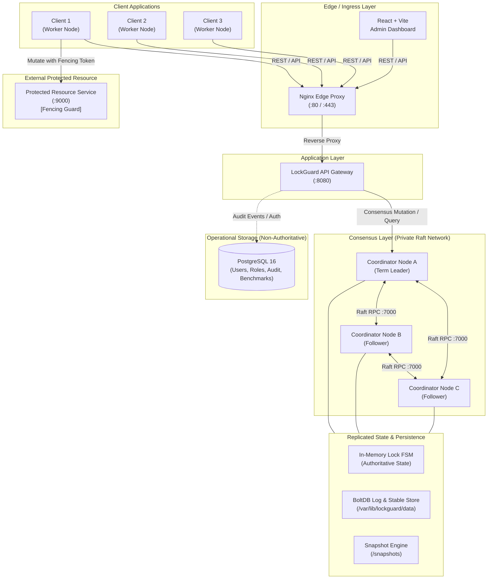

# LockGuard Architecture Specification

## 1. System Overview & Core Identity

**LockGuard** is an enterprise-grade, fault-tolerant distributed coordination service providing exclusive access to named shared resources across distributed client applications.

### Core Design Principle
> **CONSISTENCY FIRST — FAIL CLOSED**
> In any network partition, hardware failure, or quorum ambiguity, LockGuard strictly prioritizes safety (mutual exclusion and linearizability) over availability. Under no circumstance will split-brain or stale lock issuance be tolerated.

---

## 2. Distributed Architecture Diagram



---

## 3. High-Level Component Responsibilities

| Component | Responsibility | Failure Behavior |
| :--- | :--- | :--- |
| **Edge Proxy (Nginx)** | TLS termination, path routing (`/api` vs `/` dashboard), health probe aggregation. | Returns 502/504 on upstream outage. |
| **API Gateway (Go)** | HTTP request validation, authentication, leader redirection, client error formatting. | Stateless, horizontally scalable. |
| **Coordinator Cluster** | 3-node HashiCorp Raft group maintaining the single authoritative lock state machine. | Fail closed if fewer than 2 nodes active. |
| **Deterministic State Machine (`lockstate`)** | Pure in-memory state transitions (acquire, renew, release, expire), monotonic fencing tokens, and request idempotency. | Operates deterministically; encapsulated by Raft FSM. |
| **BoltDB & Snapshots** | Durable write-ahead consensus log (`raft.db`) and stable metadata (`stable.db`). | Local disk persistence per coordinator node. |
| **PostgreSQL 16** | System users, roles, audit history, benchmark results, and dashboard preferences. | Not in hot consensus path; outages do not compromise locks. |
| **Protected Resource** | Independent service validating strictly monotonic fencing tokens before executing writes. | Drops stale requests with `409 Conflict`. |

---

## 4. Raft Cluster Rules & Quorum Mathematics

### Cluster Sizing
The cluster consists of $N = 3$ coordinator nodes (Node A, Node B, Node C).

### Majority Quorum Formula
$$\text{Quorum} = \left\lfloor \frac{N}{2} \right\rfloor + 1 = \left\lfloor \frac{3}{2} \right\rfloor + 1 = 2$$

- **Fault Tolerance:** Tolerates $F = \lfloor (N - 1) / 2 \rfloor = 1$ node failure.
- **Commit Requirement:** Any state transition (acquiring a lock, extending a lease, explicit release) must be acknowledged by at least **2 out of 3** coordinator nodes before an HTTP `200 OK` is returned to the client.

### Partition Behavior (Fail Closed)
Suppose a network partition splits the cluster into two segments: $\{A\}$ and $\{B, C\}$.
1. **Majority Segment $\{B, C\}$ ($2 \ge 2$):** Retains quorum, elects a leader if needed, and continues safely processing lock commands.
2. **Minority Segment $\{A\}$ ($1 < 2$):** Quorum cannot be achieved. Any write attempt received by $A$ fails immediately or returns `ERR_QUORUM_UNAVAILABLE`. Node $A$ steps down upon heartbeat failure.
3. **No Split-Brain:** Two disjoint majorities cannot exist simultaneously in an odd-numbered cluster.

---

## 5. Storage Division of Concerns

A fundamental architectural mandate in LockGuard is the strict separation between consensus state and relational metadata:

```
+-------------------------------------------------------------------------+
| AUTHORITATIVE LOCK STATE (Hot Path)                                     |
| Storage: Replicated Raft Log (BoltDB) + Replicated In-Memory FSM        |
| Content: Lock names, owner IDs, lease durations, monotonic fencing tokens |
| Invariant: Never committed to or read from PostgreSQL                   |
+-------------------------------------------------------------------------+
                                    |
                                    | Read-only Audit / Event Streaming
                                    v
+-------------------------------------------------------------------------+
| OPERATIONAL METADATA & GOVERNANCE (Cold Path)                           |
| Storage: PostgreSQL 16 Relational Engine                                |
| Content: Users, RBAC permissions, audit events, benchmark runs/results   |
| Invariant: Loss of PostgreSQL never stops active distributed locks      |
+-------------------------------------------------------------------------+
```

---

## 6. Fencing Token Lifecycle (Kleppmann Invariant & Lease Semantics)

To guard against asynchronous delays, JVM stop-the-world GC pauses, or network delays where an expired lock holder mistakenly executes mutations:
1. Each lock acquisition increments an atomic **monotonic fencing token** ($T_{k+1} > T_k$) bound to an authoritative `OwnerID`.
2. The client supplies both the fencing token and its `OwnerID` with any mutation payload directed to the **Protected Resource**.
3. The Protected Resource tracks $(T_{accepted}, \text{OwnerID})$ for each resource independently.
4. **Validation Rules:**
   - **$T < T_{accepted}$:** Rejected unconditionally as stale (`ERR_FENCING_TOKEN_STALE`).
   - **$T == T_{accepted}$:** Accepted if and only if `OwnerID` matches the current leaseholder who established this epoch, enabling repeated legitimate writes under the same active lease. If `OwnerID` mismatches, rejected with `ERR_OWNER_MISMATCH`.
   - **$T > T_{accepted}$:** Accepted as a newer lease epoch; atomically advances $T_{accepted} \leftarrow T$ and assigns `OwnerID`. Stale owners from superseded epochs are permanently barred from writing.

---

## 7. Deterministic State Machine Role (`backend/internal/lockstate`)

The core locking engine is intentionally decoupled from network consensus:
1. **Deterministic Execution:** The engine computes deterministic outcomes using logical timestamps anchored to command commit headers ($\max(\text{cmd.Timestamp}, \text{lastApplied})$). It never calls system wall clocks during state mutation.
2. **Encapsulation by Raft FSM:** In Phase 1B, HashiCorp Raft's `FSM` implementation will wrap this `MemoryStateMachine`. Raft handles cluster consensus, term negotiation, log replication across nodes, and snapshotting. Once a log entry reaches majority commitment, Raft invokes `Apply()`, which executes the transition deterministically on the underlying `MemoryStateMachine`.
3. **Idempotency Layer:** All commands carry a `RequestID` and are hashed with SHA-256 canonical fingerprints, preventing duplicate side-effects during client retries or network replays.

---

## 8. Phase Implementation Roadmap

- **Phase 0 (Completed):** Monorepo foundation, Go backend HTTP/logging/health scaffolding, React/Vite/Tailwind dashboard shell, PostgreSQL migrations, Docker Compose topology, Raft library evaluation.
- **Phase 1A (Completed):** Deterministic concurrency-safe in-memory lock state machine (`backend/internal/lockstate`), monotonic fencing tokens, lease version tracking, exact 5-tuple expiration matching, lease transition rules, request idempotency, 37 unit & concurrency test suites passed with zero race conditions (`-race`).
- **Phase 1B (Completed):** HashiCorp Raft Consensus Integration and Three-Node Coordinator Cluster (`backend/internal/consensus`, `backend/internal/coordinator`). Encapsulates `MemoryStateMachine` in a production-grade `raft.FSM`, implements versioned command codecs, deterministic snapshotting/compaction, safe 3-node cluster bootstrap, leader-directed command submission, follower rejection with leader hints (`ERR_NOT_LEADER`), fail-closed quorum enforcement ($Q=2$), linearizable reads (`VerifyLeader` + `Barrier`), leader failover, and BoltDB durability.
- **Phase 2 (Completed):** Distributed API Gateway Routing (`backend/internal/gateway`), Client Heartbeat Management (`backend/internal/heartbeat`), and Automated Lease Renewal Manager (`backend/internal/renewal`). Transparent leader reverse-proxy with follower 421 redirection (`X-Raft-Leader-ID`), cached leader discovery with TTL, concurrency-safe client heartbeat sessions with background scrubber, dynamic $T_{\text{renew}}$ lease renewal scheduling with idempotency preservation on ambiguous timeouts, bounded exponential backoff with jitter, Prometheus metrics registry (`/metrics`), interactive React dashboard, Docker Compose integration, and 9 comprehensive integration scenarios (A-I) verified with zero data races.
- **Phase 3 (Completed):** Durable Operational Audit Trail, PostgreSQL Persistence & Operational Reliability (`backend/internal/persistence`, `backend/internal/audit`, `backend/internal/recovery`). Implements an append-only, asynchronous audit pipeline with bounded in-memory queueing (10,000 events), backpressure handling, micro-batching, and exponential backoff retry with jitter. Features automated versioned SQL migrations under PostgreSQL advisory locks (`pg_advisory_lock`), SHA-256 checksum verification, and rich Audit Query APIs (`/v1/audit/events`). Introduces multi-component system diagnostics (`/v1/recovery/diagnostics`) strictly distinguishing Raft consensus authority from database storage. Guarantees that Raft lock operations proceed uninterrupted during database outages. Includes full frontend audit dashboard integration and backup/disaster recovery procedures.
- **Phase 4 (Pending):** Protected resource service integration, network fault injection, partition simulation.
- **Phase 5 (Pending):** High-throughput benchmarking suite, Prometheus instrumentation, latency profiling.

---

## 9. Security Architecture, Identity Model & Deployment Boundary

### 9.1 Trusted-Intranet Deployment Boundary
Following the established distributed coordination service paradigm (Google Chubby, Apache ZooKeeper, HashiCorp Consul), LockGuard is engineered for **trusted-intranet deployment** within a secure VPC, Kubernetes cluster network, or private subnet:
- **Perimeter Security:** Public network traffic terminates at the edge reverse proxy (Nginx / Ingress Controller), where TLS termination and perimeter authentication occur.
- **Intra-Cluster Network:** The Raft coordinator network (`:7000`) and internal API Gateway (`:8080`) are isolated from untrusted public clients.
- **Byzantine Fault Boundary:** LockGuard assumes crash-fault-tolerant (CFT) semantics rather than Byzantine-fault-tolerant (BFT) semantics. Protection against malicious arbitrary packet tampering is delegated to TLS/mTLS and network access control lists (ACLs).

### 9.2 Client Identity & Session Token Boundary
- **Registration Claim:** Client processes claim a logical `OwnerID` (e.g. `billing-worker`) and unique instance `ClientID` (e.g. `pod-billing-01`).
- **Session Credential Issuance:** Upon successful registration (`POST /v1/clients/register`), the Gateway issues a cryptographically secure, unguessable 128-bit hex `session_id`.
- **Anti-Harvesting Protection:** Active client sessions cannot be re-registered (`ERR_CONFLICT`). Re-registering an already active client ID is rejected, preventing attackers from harvesting an active worker's secret `session_id`.
- **Credential Redaction:** Secret session IDs are automatically redacted (`[REDACTED]`) in all monitoring and inspection endpoints (`GET /v1/clients`, `GET /v1/clients/{id}`), preventing passive credential leakage to observability tooling.

### 9.3 Renewal Start & Mutual Exclusion Authorization
Before automated lease renewal can commence (`POST /v1/renewal/start`), the system enforces strict dual-layer authorization:
1. **Session Authorization:** The caller must supply a valid `session_id` that is currently active and belongs to the registered `OwnerID`.
2. **Authoritative State Machine Authorization:** The Renewal Manager queries the authoritative Raft leader (`GetLock`) to confirm:
   - The named resource exists and is currently locked.
   - The authoritative lock is held by the caller's `OwnerID`.
   - The caller's `FencingToken` matches the exact active epoch generation.
   - The lease has not expired.
   - The caller's `LeaseVersion` is not superseded.
An unauthorized session or stale worker cannot initiate renewals for another client's lock.

### 9.4 Session Lifecycle Enforcement
- **Heartbeat Protection:** `POST /v1/clients/heartbeat` rejects invalid or mismatched `session_id`s with HTTP 403 `ERR_FORBIDDEN`.
- **Session Closure Protection:** `DELETE /v1/clients/{id}` requires the exact secret `session_id` matching the registered session.
- **Renewal Worker Halting:** `POST /v1/renewal/stop` requires the active worker's `session_id`. Stale workers or cross-session callers are barred from terminating workers.
- **Scoped Expiration Scrubber:** Expiration of session $S_1$ cancels only workers registered to $S_1$; all other active client workers remain completely unaffected.
