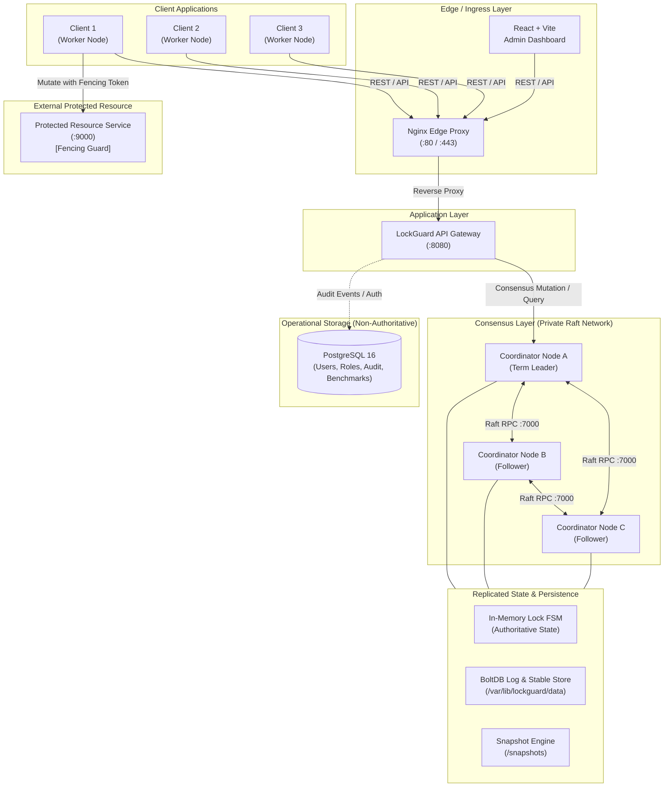

# LockGuard Architecture Specification

## 1. System Overview & Core Identity

**LockGuard** is an enterprise-grade, fault-tolerant distributed coordination service providing exclusive access to named shared resources across distributed client applications.

### Core Design Principle
> **CONSISTENCY FIRST — FAIL CLOSED**
> In any network partition, hardware failure, or quorum ambiguity, LockGuard strictly prioritizes safety (mutual exclusion and linearizability) over availability. Under no circumstance will split-brain or stale lock issuance be tolerated.

---

## 2. Distributed Architecture Diagram



---

## 3. High-Level Component Responsibilities

| Component | Responsibility | Failure Behavior |
| :--- | :--- | :--- |
| **Edge Proxy (Nginx)** | TLS termination, path routing (`/api` vs `/` dashboard), health probe aggregation. | Returns 502/504 on upstream outage. |
| **API Gateway (Go)** | HTTP request validation, authentication, leader redirection, client error formatting. | Stateless, horizontally scalable. |
| **Coordinator Cluster** | 3-node HashiCorp Raft group maintaining the single authoritative lock state machine. | Fail closed if fewer than 2 nodes active. |
| **Replicated State Machine** | In-memory index of active leases, owners, expiration timers, and fencing counters. | Rebuilt deterministically from Raft log / snapshots. |
| **BoltDB & Snapshots** | Durable write-ahead consensus log (`raft.db`) and stable metadata (`stable.db`). | Local disk persistence per coordinator node. |
| **PostgreSQL 16** | System users, roles, audit history, benchmark results, and dashboard preferences. | Not in hot consensus path; outages do not compromise locks. |
| **Protected Resource** | Independent service validating strictly monotonic fencing tokens before executing writes. | Drops stale requests with `409 Conflict`. |

---

## 4. Raft Cluster Rules & Quorum Mathematics

### Cluster Sizing
The cluster consists of $N = 3$ coordinator nodes (Node A, Node B, Node C).

### Majority Quorum Formula
$$\text{Quorum} = \left\lfloor \frac{N}{2} \right\rfloor + 1 = \left\lfloor \frac{3}{2} \right\rfloor + 1 = 2$$

- **Fault Tolerance:** Tolerates $F = \lfloor (N - 1) / 2 \rfloor = 1$ node failure.
- **Commit Requirement:** Any state transition (acquiring a lock, extending a lease, explicit release) must be acknowledged by at least **2 out of 3** coordinator nodes before an HTTP `200 OK` is returned to the client.

### Partition Behavior (Fail Closed)
Suppose a network partition splits the cluster into two segments: $\{A\}$ and $\{B, C\}$.
1. **Majority Segment $\{B, C\}$ ($2 \ge 2$):** Retains quorum, elects a leader if needed, and continues safely processing lock commands.
2. **Minority Segment $\{A\}$ ($1 < 2$):** Quorum cannot be achieved. Any write attempt received by $A$ fails immediately or returns `ERR_QUORUM_UNAVAILABLE`. Node $A$ steps down upon heartbeat failure.
3. **No Split-Brain:** Two disjoint majorities cannot exist simultaneously in an odd-numbered cluster.

---

## 5. Storage Division of Concerns

A fundamental architectural mandate in LockGuard is the strict separation between consensus state and relational metadata:

```
+-------------------------------------------------------------------------+
| AUTHORITATIVE LOCK STATE (Hot Path)                                     |
| Storage: Replicated Raft Log (BoltDB) + Replicated In-Memory FSM        |
| Content: Lock names, owner IDs, lease durations, monotonic fencing tokens |
| Invariant: Never committed to or read from PostgreSQL                   |
+-------------------------------------------------------------------------+
                                    |
                                    | Read-only Audit / Event Streaming
                                    v
+-------------------------------------------------------------------------+
| OPERATIONAL METADATA & GOVERNANCE (Cold Path)                           |
| Storage: PostgreSQL 16 Relational Engine                                |
| Content: Users, RBAC permissions, audit events, benchmark runs/results   |
| Invariant: Loss of PostgreSQL never stops active distributed locks      |
+-------------------------------------------------------------------------+
```

---

## 6. Fencing Token Lifecycle (Kleppmann Invariant)

To guard against asynchronous delays, JVM stop-the-world GC pauses, or network delays where an expired lock holder mistakenly executes mutations:
1. Each lock acquisition increments an atomic **monotonic fencing token** ($T_{k+1} > T_k$).
2. The client must supply this token with any mutation payload directed to the **Protected Resource**.
3. The Protected Resource tracks $T_{max} = \max(T_{observed})$.
4. If a client presents $T_{client} \le T_{max}$, the mutation is rejected with `ERR_FENCING_TOKEN_STALE`.

---

## 7. Phase Implementation Roadmap

- **Phase 0 (Current):** Monorepo foundation, Go backend HTTP/logging/health scaffolding, React/Vite/Tailwind dashboard shell, PostgreSQL migrations, Docker Compose topology, Raft library evaluation.
- **Phase 1:** Raft consensus engine integration, election verification, 3-node coordinator orchestration, replicated state machine.
- **Phase 2:** Distributed lock API (`acquire`, `release`, `renew`), lease TTL manager, fencing token generation.
- **Phase 3:** BoltDB log storage, automated snapshots, crash recovery, state restoration.
- **Phase 4:** Protected resource service integration, network fault injection, partition simulation.
- **Phase 5:** High-throughput benchmarking suite, Prometheus instrumentation, latency profiling.
