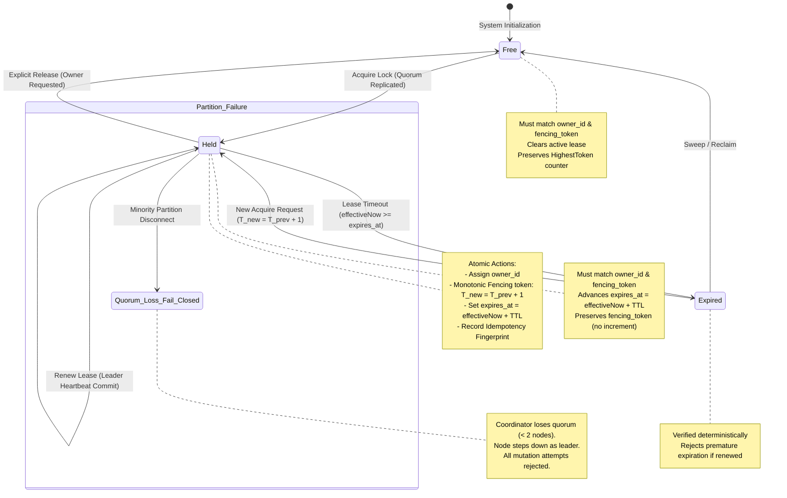
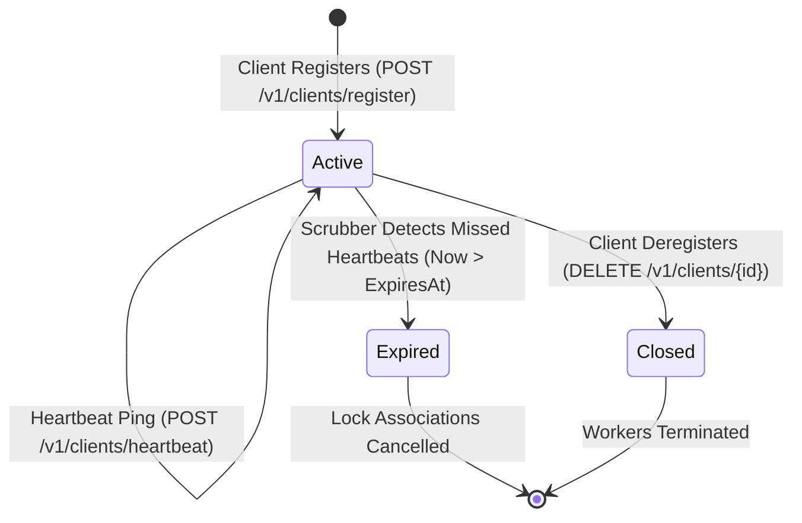
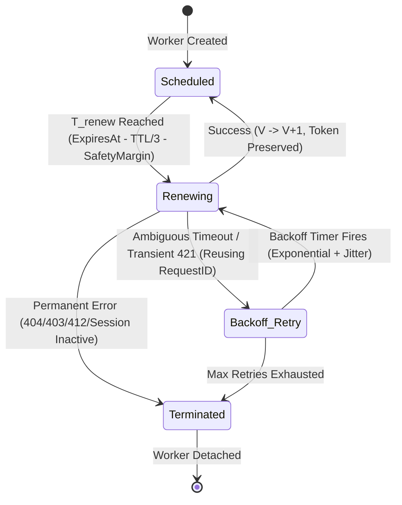
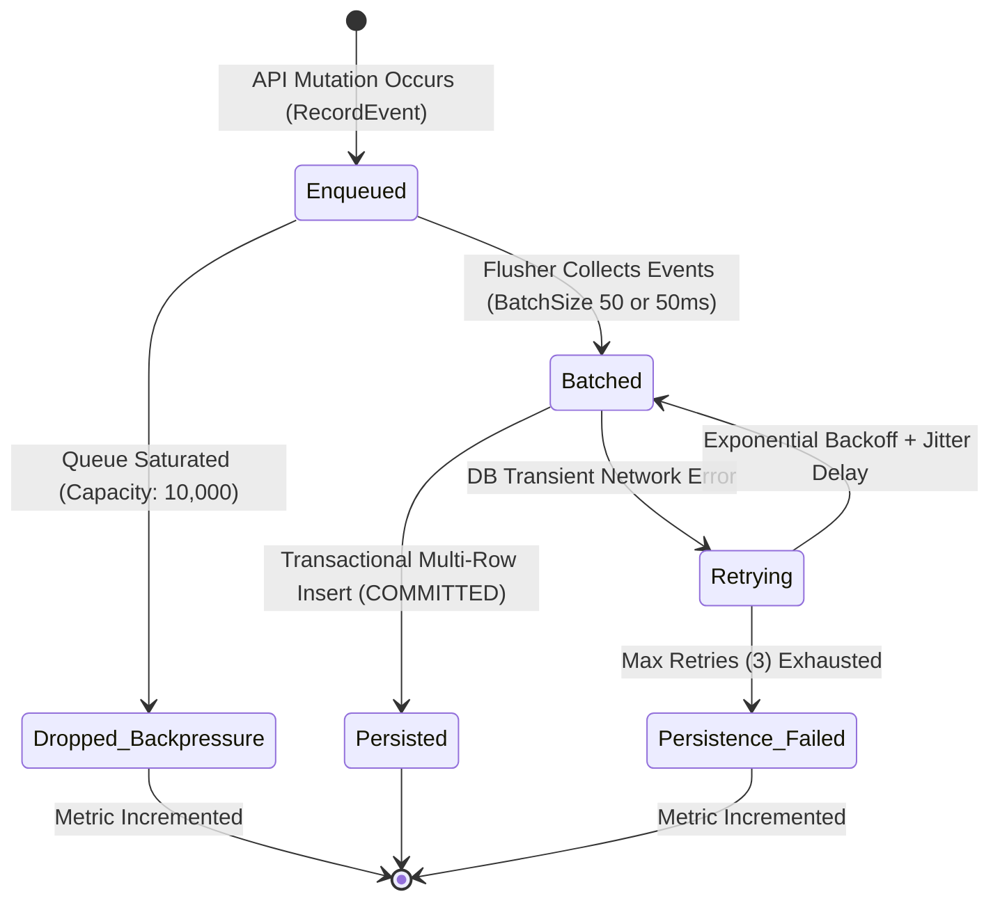
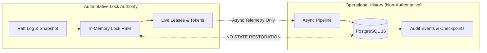

# LockGuard Distributed State Model

## 1. State Lifecycle Diagram



---

## 2. Lock State Definitions

| State | Condition | Mutability |
| :--- | :--- | :--- |
| **`FREE`** | No active lease exists for resource name (`ActiveLock == nil`). | Any client may attempt acquisition. |
| **`HELD`** | Active lease held by `owner_id`; `effectiveNow < expires_at`. | Only matching `(owner_id, fencing_token)` can renew or release. |
| **`EXPIRED`** | Lease elapsed (`effectiveNow >= expires_at`) without renewal. | Mutual exclusion terminates; immediately available for new acquire. |
| **`FAIL_CLOSED`** | Cluster quorum (< 2 nodes) unavailable. | All state transitions strictly frozen; writes rejected. |

---

## 3. Data Types & Record Structure (`backend/internal/lockstate`)

### 3.1 `LockRecord`
Represents an active or expired lock lease bound to a specific owner:
- **`ResourceName`** (`string`): The unique identifier of the target lock resource.
- **`OwnerID`** (`string`): Identity string of the acquiring client/worker.
- **`FencingToken`** (`uint64`): Monotonically increasing 64-bit epoch token issued at acquisition. Identifies an ownership epoch.
- **`LeaseVersion`** (`uint64`): Monotonically increasing 64-bit version counter identifying a specific lease instance within the ownership epoch. Starts at 1 on acquire; increments by 1 on each renewal.
- **`Status`** (`LockStatus`): State of the lock (`HELD` or `EXPIRED`).
- **`AcquiredAtUnixNano`** (`int64`): Nanosecond Unix timestamp when the lock was acquired.
- **`RenewedAtUnixNano`** (`int64`): Nanosecond Unix timestamp of the most recent renewal.
- **`ExpiresAtUnixNano`** (`int64`): Nanosecond Unix timestamp when the active lease expires.

### 3.2 `ResourceState`
Represents the complete state and historical counters for a named resource:
- **`ResourceName`** (`string`): Resource identifier.
- **`ActiveLock`** (`*LockRecord`): Pointer to the current active lease, or `nil` if free.
- **`HighestToken`** (`uint64`): Highest fencing token ever issued for this resource. **Never resets or decrements** across releases or expirations.

---

## 4. State Transition Rules

### 4.1 Acquire Lock (`AcquireLockCommand`)
1. **Validation:** Checks that `ResourceName`, `OwnerID`, and `RequestID` are non-empty, `TTL > 0`, `TimestampUnixNano > 0`, and `TTL <= math.MaxInt64 - TimestampUnixNano` (rejects with `ErrArithmeticOverflow`).
2. **Idempotency Check:** If `RequestID` was previously applied:
   - If payload fingerprint matches, return cached `Result` immediately.
   - If payload fingerprint differs, reject with `ErrIdempotencyConflict`.
3. **Lease Evaluation:**
   - Retrieve `ResourceState`. If `ActiveLock != nil`:
     - If `effectiveNow < activeLock.ExpiresAtUnixNano`, reject with `ErrLockAlreadyHeld`.
     - If `effectiveNow >= activeLock.ExpiresAtUnixNano`, mark previous lease expired.
4. **Token Generation & Overflow Protection:**
   - Verify `HighestToken < math.MaxUint64` (reject with `ErrTokenExhausted` on overflow).
   - Check arithmetic overflow against `effectiveNow`: `effectiveNow <= math.MaxInt64 - TTLNano` (reject with `ErrArithmeticOverflow`).
   - `newToken = HighestToken + 1`.
5. **State Mutation:**
   - Set `HighestToken = newToken`.
   - Set `ActiveLock` to new `LockRecord` with status `HELD`, `FencingToken = newToken`, **`LeaseVersion = 1`**, `AcquiredAtUnixNano = effectiveNow`, `ExpiresAtUnixNano = effectiveNow + TTLNano`.
   - Store idempotency record.

### 4.2 Renew Lease (`RenewLockCommand`)
1. **Validation:** Validates non-empty fields, `TTL > 0`, `FencingToken > 0`, and checks `TTL <= math.MaxInt64 - TimestampUnixNano` (rejects with `ErrArithmeticOverflow`).
2. **Idempotency Check:** Replays return cached `Result` on matching fingerprint; conflict error on mismatch. Replays do NOT increment `LeaseVersion` twice.
3. **Lease Evaluation:**
   - Must have `ActiveLock != nil` (else `ErrLockNotFound`).
   - `ActiveLock.OwnerID` must equal command `OwnerID` (else `ErrNotOwner`).
   - `ActiveLock.FencingToken` must equal command `FencingToken` (else `ErrFencingTokenMismatch`).
   - Must not be expired: if `effectiveNow >= ActiveLock.ExpiresAtUnixNano`, reject with `ErrLeaseExpired`.
   - Check arithmetic overflow: `effectiveNow <= math.MaxInt64 - TTLNano` (reject with `ErrArithmeticOverflow`).
   - Check lease version overflow: `ActiveLock.LeaseVersion < math.MaxUint64` (reject with `ErrVersionExhausted`).
4. **State Mutation:**
   - **`LeaseVersion = ActiveLock.LeaseVersion + 1`**.
   - `ExpiresAtUnixNano = effectiveNow + TTLNano`.
   - `FencingToken` **remains unchanged** (renewals never increment fencing tokens).
   - Store idempotency record.

### 4.3 Release Lock (`ReleaseLockCommand`)
1. **Validation:** Validates non-empty fields and `FencingToken > 0`.
2. **Idempotency Check:** Replays return cached `Result` on matching fingerprint; conflict error on mismatch.
3. **Lease Evaluation:**
   - Must have `ActiveLock != nil` (else `ErrLockNotFound`).
   - `ActiveLock.OwnerID` must equal command `OwnerID` (else `ErrNotOwner`).
   - `ActiveLock.FencingToken` must equal command `FencingToken` (else `ErrFencingTokenMismatch`).
   - If `effectiveNow >= ActiveLock.ExpiresAtUnixNano`, reject with `ErrLeaseExpired` without mutating state.
4. **State Mutation:**
   - `ActiveLock = nil`.
   - `HighestToken` is **preserved** (never decremented).
   - Store idempotency record.

### 4.4 Expire Lock (`ExpireLockCommand`)
1. **Validation:** Validates non-empty fields, `ExpectedFencingToken > 0`, `ExpectedLeaseVersion > 0`, and `ExpectedExpiresAtUnixNano > 0`.
2. **Idempotency Check:** Replays return cached `Result` on matching fingerprint; conflict error on mismatch.
3. **Lease Evaluation:**
   - Must have `ActiveLock != nil` (else `ErrLockNotFound`).
   - `ActiveLock.OwnerID` must equal `ExpectedOwnerID` (else `ErrNotOwner`).
   - `ActiveLock.FencingToken` must equal `ExpectedFencingToken` (else `ErrFencingTokenMismatch`).
   - **Stale Expiration & Lease Instance Guard:** `ActiveLock.LeaseVersion` must equal `cmd.ExpectedLeaseVersion` (else `ErrLeaseVersionMismatch`).
   - **Expiration Timestamp Safety Check:** `ActiveLock.ExpiresAtUnixNano` must equal `cmd.ExpectedExpiresAtUnixNano` (else `ErrLeaseVersionMismatch`).
   - **Premature Expiration Guard:** If `effectiveNow < ActiveLock.ExpiresAtUnixNano`, reject with `ErrInvalidExpiration`.
4. **State Mutation:**
   - `ActiveLock = nil`.
   - Store idempotency record.

---

## 5. Deterministic Time & Monotonic Clock Policy

Distributed consensus state machines require absolute determinism across all replicas:
1. **Zero System Clock Calls:** The state machine **never** calls `time.Now()` or reads host clocks during command execution.
2. **Leader-Anchored Monotonicity:** Every state transition calculates logical time strictly using:
   $$\text{effectiveNow} = \max(\text{cmd.TimestampUnixNano}, s.\text{lastAppliedUnixNano})$$
3. **Monotonic Forward Progress:** $s.\text{lastAppliedUnixNano}$ is updated to $\text{effectiveNow}$ upon every applied command, guaranteeing time never regresses even if an upstream clock jitters.
4. **Replay Determinism:** Replaying the identical sequence of Raft log commands on any node reconstructs the exact same in-memory state.

---

## 6. Mathematical Monotonicity Proof

Let $S_k$ denote the replicated state machine at log index $k$.
Let $F(S_k, R)$ be the highest fencing token issued for resource $R$ at state $S_k$.

### Invariant 1: Strictly Monotonic Fencing Tokens
$$\forall k \ge 0, \quad F(S_{k+1}, R) \ge F(S_k, R)$$
With strict inequality $F(S_{k+1}, R) > F(S_k, R)$ on any successful `AcquireLock` transition.

### Invariant 2: Mutual Exclusion
At any logical state $S_k$, for any named resource $R$:
$$|\{c \in \text{Clients} \mid \text{HoldsLock}(c, R, S_k)\}| \le 1$$

### Invariant 3: Quorum Intersection
Let $Q_1$ and $Q_2$ be any two majorities of cluster nodes $N = \{A, B, C\}$ ($|Q_1| \ge 2, |Q_2| \ge 2$).
By the Pigeonhole Principle:
$$Q_1 \cap Q_2 \neq \emptyset$$
Therefore, no two leaders can commit divergent states in the same Raft term.

---

## 7. State Snapshot & Compaction Model (`SnapshotData`)

To truncate the Raft log and onboard new or lagging replicas, LockGuard exports deterministic state snapshots (`lockstate.SnapshotData`):

```go
type SnapshotData struct {
    Version             uint32              `json:"version"`
    LastAppliedUnixNano int64               `json:"last_applied_unix_nano"`
    Resources           []ResourceState     `json:"resources"`
    IdempotencyRecords  []IdempotencyRecord `json:"idempotency_records"`
}
```

### 7.1 Snapshot Determinism Guarantees
1. **Sorted Ordering:** Map entries for `Resources` are sorted ascending by `ResourceName`. Map entries for `IdempotencyRecords` are sorted ascending by `RequestID`. This guarantees identical binary/JSON snapshot representations regardless of in-memory Go map iteration order.
2. **Deep Cloning:** All lock records, fencing counters, and idempotency results are deep-copied under read lock.
3. **Atomic Restore:** When `RestoreSnapshot()` is called by Raft, existing in-memory state is atomically cleared and reconstructed from the snapshot stream.
4. **Replay Equivalence:** Restoring a snapshot at index $I$ followed by applying log entries $I+1 \dots N$ yields the exact same state machine state as applying $1 \dots N$ from genesis.

---

## 8. Phase 2 Client Heartbeat & Renewal Worker State Models

### 8.1 Client Session Lifecycle


### 8.2 Renewal Worker Execution Model


---

## 9. Phase 3 Operational Persistence & Audit Event State Model

### 9.1 Audit Event Pipeline Lifecycle


### 9.2 Non-Authoritative State Invariant


