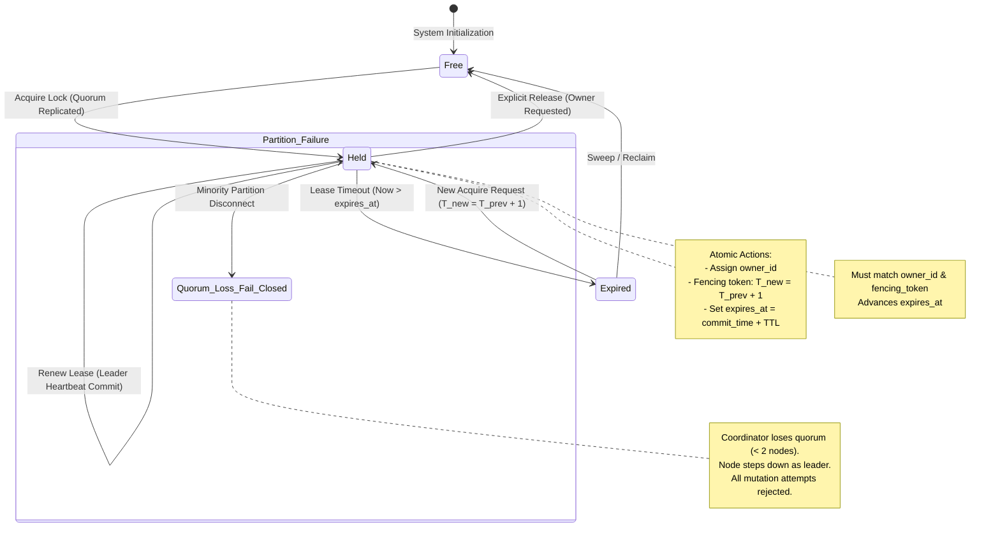

# LockGuard Distributed State Model

## 1. State Lifecycle Diagram

---

## 2. Lock State Definitions

| State | Condition | Mutability |
| :--- | :--- | :--- |
| **`FREE`** | No active lease exists for resource name. | Any client may attempt acquisition. |
| **`HELD`** | Active lease held by `owner_id`; `Now() < expires_at`. | Only matching `(owner_id, fencing_token)` can renew or release. |
| **`EXPIRED`** | Lease elapsed (`Now() >= expires_at`) without renewal. | Mutual exclusion terminates; immediately available for new acquire. |
| **`FAIL_CLOSED`** | Cluster quorum (< 2 nodes) unavailable. | All state transitions strictly frozen; writes rejected. |

---

## 3. Mathematical Monotonicity Proof

Let $S_k$ denote the replicated state machine at log index $k$.
Let $F(S_k)$ be the highest fencing token issued by state $S_k$.

### Invariant 1: Strictly Monotonic Fencing Tokens
$$\forall k \ge 0, \quad F(S_{k+1}) > F(S_k)$$

### Invariant 2: Mutual Exclusion
At any logical state $S_k$, for any named resource $R$:
$$|\{c \in \text{Clients} \mid \text{HoldsLock}(c, R, S_k)\}| \le 1$$

### Invariant 3: Quorum Intersection
Let $Q_1$ and $Q_2$ be any two majorities of cluster nodes $N = \{A, B, C\}$ ($|Q_1| \ge 2, |Q_2| \ge 2$).
By the Pigeonhole Principle:
$$Q_1 \cap Q_2 \neq \emptyset$$
Therefore, no two leaders can commit divergent states in the same Raft term.
